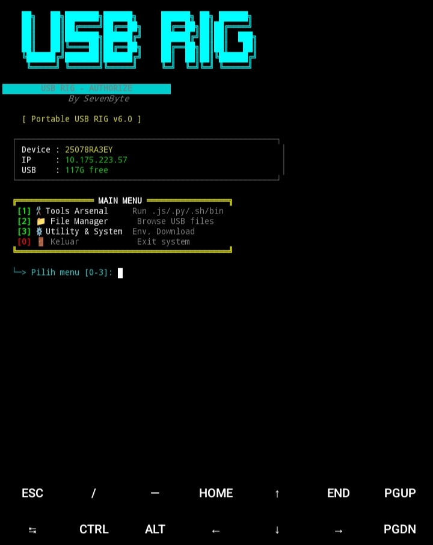

# USB RIG👨‍💻

> **Portable Hacking Toolkit Launcher** — Build to Understand, Automate to Scale.  
> Framework launcher multi-bahasa berbasis Node.js yang dirancang khusus untuk berjalan langsung dari **USB Flash Drive** di Android (Termux). Mengubah USB biasa menjadi Basecamp portabel untuk Security Researcher, Bug Hunter, dan Builder.

<p align="center">
  <a href="https://f-droid.org/packages/com.termux/" target="_blank">
    
  </a>
  <a href="https://nodejs.org/" target="_blank">
    
  </a>
  <a href="https://github.com/Fly3417/usb-rig/releases" target="_blank">
    
  </a>
  <a href="https://www.android.com/intl/id_id/transfer-files/#how-to-use-usb-otg" target="_blank">
    
  </a>
  <a href="https://github.com/Fly3417/usb-rig/blob/main/LICENSE" target="_blank">
    
  </a>
</p>

## 📸 Tampilan Framework

<p align="center">
  
</p>

<p align="center">
  <i>USB RIG — Interactive CLI Interface</i>
</p>

---
## 🚀 Fitur Utama

`USB RIG` membagi proses Pentesting portabel menjadi beberapa modul otomatis:

<details>
<summary><b>1. Multi-Language Executor</b></summary>
<br>

- **Auto-Detect Engine:** Jalankan file `.js`, `.py`, `.sh`, atau *compiled binary* (Go/C) langsung dari USB tanpa perlu setup interpreter manual.
- **Cache Execution:** Bypass noexec flag pada filesystem Android dengan mengeksekusi binary via internal cache Termux.
- **Auto-Args:** Masukkan argumen tambahan (seperti IP target atau range port) langsung dari UI sebelum eksekusi.
</details>

<br>

<details>
<summary><b>2. Web File Manager (Drag & Drop)</b></summary>
<br>

- **Upload via Wi-Fi:** Nyalakan Web Server di background, lalu akses via browser PC/Laptop.
- **Web Editor:** Edit file teks (`.js`, `.py`, `.sh`) langsung dari browser PC tanpa perlu `nano` atau `vim`.
- **Rename & Delete:** Kelola file dan folder di USB secara real-time dari PC.
</details>

<br>

<details>
<summary><b>3. SDCard Explorer & Importer</b></summary>
<br>

- **Native File Picker:** Copy file dari internal storage (`/sdcard/`) ke dalam USB tanpa butuh Termux:API.
- **Target Folder Dinamis:** Pilih folder tujuan (termasuk bikin folder baru) langsung dari terminal.
</details>

<br>

<details>
<summary><b>4. GitHub Auto-Installer</b></summary>
<br>

- **Clone & Setup:** Clone repo dari GitHub.
- **Auto-Detect Dependencies:** Otomatis mendeteksi dan menjalankan `npm install`, `pip install`, `go mod tidy`, atau `setup.sh`.
</details>

<br>

<details>
<summary><b>5. Port Scanner & Killer</b></summary>
<br>

- **Port Checker:** Scan port lokal (1-65535) untuk mencari proses yang hang.
- **Process Killer:** Bunuh Web Server yang nyangkut tanpa mematikan Launcher utama.
</details>

---
## ⚙️ Instalasi Cepat (Termux)

Pastikan kamu sudah menginstal **Termux** (disarankan dari F-Droid) dan **USB OTG** sudah dicolokkan ke HP. 

Buka Termux, lalu **copy-paste seluruh perintah di bawah ini** (otomatis setup USB, install dependencies, clone repo, dan bikin alias):

```bash
# 1. Update & Install Dependencies
pkg update -y && pkg upgrade -y
pkg install nodejs python golang git curl -y

# 2. Izin Akses Storage (Klik 'Allow' di popup Android)
termux-setup-storage

# 3. Deteksi USB & Setup Folder
USB_PATH=$(find /storage -maxdepth 1 -type d -name "????-????" | head -n 1)
if [ -z "$USB_PATH" ]; then
    echo "❌ USB tidak terdeteksi! Pastikan USB OTG sudah dicolok."
    exit 1
fi
echo "✅ USB terdeteksi di: $USB_PATH"

# 4. Masuk ke Folder Private Termux di USB
TARGET_DIR="$USB_PATH/Android/data/com.termux/files"
mkdir -p "$TARGET_DIR"
cd "$TARGET_DIR" || exit 1

# 5. Clone Repo & Install Module
if [ ! -d ".git" ]; then
    git clone https://github.com/Fly3417/usb-rig.git .
fi
npm install

# 6. Bikin Alias 'usb'
echo "alias usb=\"bash $TARGET_DIR/run.sh\"" >> ~/.bashrc
source ~/.bashrc

# 7. Jalankan Launcher
echo "🚀 Menjalankan USB RIG..."
bash run.sh
---
```
## 📂 Struktur Project

Berikut adalah struktur direktori dari **USB RIG** setelah proses instalasi berhasil. Semua file inti berada di *root* folder USB, sedangkan *tools* dan *logs* terpisah di dalam folder masing-masing.

```
/USB_ROOT/Android/data/com.termux/files/
│
├── CORE SYSTEM
│   ├── run.sh              # Entry point (Auto-detect USB & Launch UI)
│   ├── index.js            # Main Router (Otak navigasi menu)
│   ├── ui.js               # Tampilan Terminal (ASCII Art & Warna)
│   ├── webserver.js        # Web File Manager (Drag & Drop via Wi-Fi)
│   └── package.json        # Dependensi Node.js (Chalk)
│
├── CONFIG & UTILS
│   ├── config.js           # Manajemen WorkDir & History
│   ├── config.json         # File konfigurasi global (Versi, Author)
│   ├── utils.js            # Helper (Warna, Format Size, Logger)
│   ├── folder.js           # Logika navigasi folder
│   └── picker.js           # Logika pemilihan file (Rekursif)
│
├── WORKSPACE (Tempat kamu naruh file)
│   ├── tools/              # Wajib: Taruh tool hacking di sini (.js, .py, .sh, .bin)
│   ├── payloads/           # Wajib: Taruh file payload (SQLi, LFI, Webshell)
│   ├── config/             # Opsional: Taruh file config khusus tool
│   └── assets/             # Opsional: Gambar screenshot UI (buat README)
│
├── LOGS & DATA
│   ├── logs/               # Auto-generated: Log eksekusi tool & Web Server
│   └── rig_config.json     # Auto-generated: Nyimpen history folder terakhir
│
└── AUTO-GENERATED (Jangan dihapus/diedit)
    ├── node_modules/       # Library Node.js (Chalk)
    └── .git/               # Folder Git (kalau di-clone)
```
## 🚧 Status Pengembangan

> [!NOTE]
> **USB RIG v10.0 (Stable)** 🟢
> 
> Framework ini stabil untuk penggunaan harian dan Bug Hunting portabel. Web Server dan File Manager sudah berjalan di background sehingga UI utama tidak akan nge-hang.
> 
> **🗺️ Roadmap Selanjutnya:**
> - [ ] 🔒 Fitur enkripsi folder `tools/` dan `payloads/` (biar aman kalau USB hilang).
> - [ ] 🔋 Integrasi API `termux-battery-status` (buat mantau baterai HP saat scanning lama).
> - [ ] 🔄 Auto-update script dari GitHub (tinggal ketik `[U]` di menu Utility).
> - [ ] 🌐 Multi-language UI (English / Indonesia).
> 
> Jika kamu menemukan bug atau memiliki saran fitur baru, silakan hubungi kontak di bawah. Kami sangat terbuka untuk feedback! 🤝

---
## ⚠️ DISCLAIMER (PENTING!)

> [!CAUTION]
> **USB RIG dibuat HANYA untuk tujuan edukasi, penelitian keamanan, dan pengujian pada sistem yang telah mendapatkan izin tertulis (Authorized Penetration Testing).** 📚
> 
> - 🚫 Penulis (**SevenByte**) tidak bertanggung jawab atas penyalahgunaan alat ini.
> - ⚖️ Menggunakan alat ini untuk menyerang target tanpa izin adalah **TINDAKAN PIDANA**.
> - 🧪 Selalu gunakan target latihan legal seperti `testphp.vulnweb.com`, lab lokal (DVWA), atau VPS milikmu sendiri.
> - 🛑 Jangan pernah menggunakan alat ini untuk aktivitas ilegal.

---
## 📬 Hubungi Saya

Kami sangat terbuka untuk *Pull Request*. Jika kamu ingin menambahkan tool baru, memperbaiki bug, atau menambahkan fitur (seperti WebSocket Scanner, C2 Dashboard, dll), silakan fork repo ini dan ajukan PR. 🚀

<p align="left">
  <a href="mailto:sevenbyte071@gmail.com">
    
  </a>
  <a href="https://t.me/Sevenbyte7">
    
  </a>
  <a href="https://github.com/Fly3417">
    
  </a>
</p>
